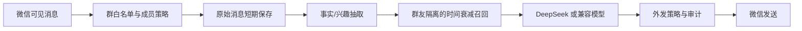

# 微信 AI Agent 测试版 PRD

版本：v0.1  
日期：2026-10-26  
状态：需求已确认，离线核心、本地控制台和受控联网研究骨架已建立，真实微信端到端联调尚未通过

## 1. 产品定义

这是一个运行在 Windows 本机的微信测试群 AI Agent。它使用一个专用、已标注为 AI 的个人微信号，只进入指定测试群，读取可见群消息，根据群级上下文和群友级画像生成回复，并保留可审计的记忆与外发记录。

第一阶段采用 RAG，不把聊天内容直接用于模型参数训练。后续积累足够数据后，再单独评估 LoRA 或微调。

## 2. 已确认的使用边界

- 只使用专用测试微信号，不操作日常微信号。
- 只处理配置的测试群，群友知道账号是 AI。
- `@AI` 或命中配置的 AI 别名的消息才进入回复流程；普通消息即使是问句也不回复。
- 群、群友、平台身份和外部资料必须隔离存储。
- 原始群聊保存 30 天；画像和事实长期保存，并支持更正、失效、导出、删除。
- 画像字段可以包含推断，但每条记录必须带来源、时间、置信度和“已确认/推断”状态。
- B 站、小红书等外部资料只采集公开内容，与群友记忆使用不同命名空间。
- 平台账号绑定必须由群友明确确认，支持多个账号和解绑，不能只靠昵称猜测。
- 抖音和小红书白名单以平台唯一用户 ID 为主键；昵称只能作为页面显示，不能授权。
- 外发动作使用群白名单、成员白名单、审计日志、异常检测和一键停机。
- 群友明确询问实时信息时，AI 可以调用受控搜索服务；网页来源只用于当前回答，不写入群友长期画像。
- 模型默认使用 DeepSeek 的 OpenAI 兼容接口，模型层可替换，后续再加入本地模型。

## 3. 第一阶段目标

### 3.1 必须实现

1. 识别已登录的 Windows Weixin 主窗口。
2. 只打开并监听配置的测试群。
3. 读取当前可见的文字消息，并按发送者去重。
4. 记录原始消息、群友事实和动作审计。
5. 强制按 `account_id + group_id + member_id` 过滤记忆。
6. 使用关键词相关性、置信度和时间衰减召回记忆。
7. 对 `@AI`/AI 别名消息生成明确标注 AI 身份的回复。
8. 允许关闭发送，只做读取、入库和候选回复生成。
9. 通过 STOP 文件立即停止监听。
10. 对明确的实时/搜索类问题调用可配置搜索 provider，并在回答上下文保留来源 URL。
11. 在平台浏览器已登录时，读取公开抖音/小红书条目和公开评论作为当前问题参考；遇到挑战页面立即停止。

### 3.2 第一阶段不做

- B 站、小红书自动写入和未经人工确认的评论；公开内容只作为后续受控采集能力。
- 图片、语音、视频消息的识别。
- 完整历史消息回放和自动翻页。
- LoRA、微调或自动改写基础人设。
- 未经明确绑定的跨平台身份匹配。
- 绕过验证码、风控、登录保护或平台限制。

## 4. 用户与核心场景

### 4.1 运营者

运营者准备专用账号和测试群，配置群名、AI 别名、白名单和模型密钥，查看日志，需要时创建 STOP 文件停机。

### 4.2 群友

群友在测试群中与 AI 交流。群友明确确认后，才可以把其 B 站或小红书账号绑定到该群友身份。绑定关系可以撤销。

### 4.3 AI 回复流程

## 5. 功能需求

### FR-01 微信连接与就绪检查

程序应找到 Weixin 主窗口，确认窗口类名、进程号和 `MainView` 控件。`ready` 命令只做检查，不打开群、不发送消息。

### FR-02 测试群隔离

必须配置 `WECHAT_GROUP_NAME`。未配置或群名不匹配时，程序不得打开或发送。监听器只处理该群产生的事件。

### FR-03 消息读取与去重

适配器读取 `chat_message_page` 中当前可见的文字行，提取发送者和文本，使用指纹避免同一可见行重复处理。媒体消息在当前版本跳过并记录限制。

### FR-04 `@AI`/别名回复

AI 别名由 `WECHAT_AI_ALIASES` 配置。消息包含别名时，必须进入回复流程，除非已触发 STOP、发送关闭或其他策略阻断。回复中应保持 AI 身份说明。AI 自己发出的消息必须跳过。

### FR-05 普通消息不回复

普通消息不进入模型和回复流程。保留 `WECHAT_PROACTIVE_REPLY` 配置字段以兼容旧 `.env`，当前策略仍要求明确 @AI 或 AI 别名。

### FR-05A 回复幂等

每条可见消息和每个规范化问题都写入持久化 `reply_records` 台账。同一事件不会重复处理；同一账号、群和成员的问题在已成功发送后再次出现时只记录跳过原因，不再调用模型。发送关闭、模型失败或客户端发送失败都不能标记为已回答，允许后续重试。

### FR-06 群友画像与事实

每条事实至少保存：

- `account_id`
- `group_id`
- `member_id`
- `memory_type`：`chat`、`interest` 或 `fact`
- 内容
- 置信度
- 状态：`confirmed`、`inferred` 或 `superseded`
- 来源事件
- 观察时间、有效起止时间
- 来源和抽取器元数据

明确的新事实可以使旧事实失效，但历史记录仍需可审计。

### FR-07 RAG 召回

召回必须先按账号、群和成员过滤，再综合：

- 文本关键词重合度
- 新鲜度
- 置信度
- 已确认状态加分

基线半衰期：聊天 14 天、兴趣 90 天、稳定事实 365 天。后续 PostgreSQL+pgvector 版本加入语义向量和 BM25 混合检索。

### FR-08 模型调用

模型接口遵循 OpenAI 兼容的 `/chat/completions`。没有 `LLM_API_KEY` 时使用本地 stub，只用于离线测试，不声称已调用 DeepSeek。

### FR-09 发送保护

发送必须同时满足：

- STOP 文件不存在；
- `WECHAT_ALLOW_SEND=true` 或命令行显式 `--allow-send`；
- 群名在白名单；
- 未触发每分钟异常速率熔断。

每次允许或拒绝的动作都写入 `action_audit`。当前配置没有每日硬额度，但保留速率熔断；真实联调前应再确认是否增加小额硬上限。

### FR-10 数据留存与删除

- `messages` 原文默认 30 天后删除。
- `memory_facts` 和 `identity_bindings` 长期保存，支持按成员更正、失效、导出和删除。
- 后续应补充管理命令或管理页面，完成按群清空和按成员操作。

### FR-11 联网问答

搜索默认关闭。开启后只对实时、搜索、来源、价格、新闻以及明确平台查询等意图调用 provider。当前支持 Brave、Tavily、自建 SearXNG 和 DSH 同款 `deepseek-search-api` 中转；provider 不可用时不阻断普通回答。DeepSeek 中转使用 `POST /v1/tools/search`，不使用 Exa 或官方 DeepSeek Messages 搜索。结果必须包含标题、URL 和摘要，模型提示词要求对外部事实保留来源链接。

网页正文抓取必须同时打开 `WEB_FETCH_ENABLED` 并匹配 `WEB_FETCH_ALLOWED_DOMAINS`。禁止把任意 URL 当作可抓取目标，禁止访问未授权内网地址。抓取的正文只保留在当前请求上下文，不能作为 `memory_facts` 写入。

### FR-12 公开平台内容参考

平台查询只使用当前已登录的可见浏览器适配器读取公开页面。每条条目必须带平台、条目 ID、URL、作者 ID（如果页面提供）和当前页面文本；评论必须带评论 ID、作者 ID（如果页面提供）和父评论 ID。没有稳定 DOM ID 的评论跳过，不按昵称猜测。平台内容与微信群友画像保持不同命名空间。

### FR-13 多模型和生图

文字问答与生图模型必须使用独立配置和独立路由。同一 agent 收到明确 @AI 的生图意图时调用 OpenAI-compatible `POST /v1/images/generations`，普通问题继续调用 `/v1/chat/completions`。生图结果当前以 URL 或受控本地文件路径作为文字回复；微信图片消息发送需要后续 UI 适配，不得把图片 URL 当成已上传的微信图片。

## 6. 数据模型

| 表 | 作用 | 当前状态 |
|---|---|---|
| `messages` | 原始群消息、30 天过期时间 | 已实现 |
| `memory_facts` | 群友事实、兴趣、聊天记忆和版本状态 | 已实现 |
| `identity_bindings` | B 站/小红书等平台绑定关系，使用平台唯一账号 ID | 表结构已实现，绑定流程未接入微信命令 |
| `action_audit` | 发送动作、@ 名单、允许/拒绝原因 | 已实现 |
| `reply_records` | 入站事件幂等、问题去重、生成/发送状态 | 已实现 |
| `platform_actions` | 抖音/小红书评论与回复计划、幂等键、dry-run/审核状态和 @ 目标记录 | dry-run 台账、唯一 ID 白名单校验和可选 Playwright 浏览器执行已接入；原生 @ 选择器和真实账号页面仍需逐平台验收 |

SQLite 用于本机原型；PostgreSQL+pgvector 迁移文件已准备，但真实向量写入和检索尚未完成。

## 7. 技术架构

- `weixin_ui.py`：Windows UIAutomation 适配器，负责窗口、群打开、可见消息读取和文本发送。
- `agent.py`：消息编排、事实抽取、召回、模型调用和动作执行。
- `storage.py`：SQLAlchemy 数据访问、留存清理、绑定和审计。
- `policy.py`：群白名单、成员白名单、`@AI` 规则、发送开关、速率熔断和 STOP。
- `llm.py`：DeepSeek/OpenAI 兼容文字客户端和无密钥 stub。
- `image.py`：可选 OpenAI-compatible 生图客户端；由 `agent.py` 按请求意图路由。
- `desktop.py`：本机 Web 桌面控制台，管理监听、STOP、台账和审计。
- `platforms/`：抖音/小红书统一浏览、评论、回复接口和 dry-run 动作计划。
- `web_research.py`：搜索 provider、域名白名单正文抓取，以及平台公开内容临时上下文。
- `main.py`：`ready`、`run`、`init-db`、`desktop` 和停机命令。

## 8. 验收标准

### A. 离线验收

- 群和成员之间的记忆不能互相召回。
- 同一事实的新记录在时间衰减下优先于旧记录。
- 相同消息重复写入不会产生重复原文。
- 未开启发送时动作被拒绝并审计。
- `@AI` 事件进入回复路径。
- 普通问句不进入模型；相同问题在重启后仍不会重复回答。
- AI 自己的可见消息不触发回复。
- 发送关闭时记录候选和审计，但不标记问题为已回答。
- 缺少模型密钥时不发起网络请求。

### B. 真实微信验收

1. `ready` 能看到已登录专用测试账号和 `MainView`。
2. 监听器只打开配置测试群。
3. 测试群发送一条 `@AI` 消息后，程序读取到正确发送者和文本。
4. 生成的回复在微信客户端中实际出现，并由客户端可见结果确认发送成功。
5. 另一群或另一群友的记忆不会进入当前提示词。
6. 创建 STOP 文件后不再读取新消息或发送动作。
7. `action_audit` 中存在完整允许/拒绝记录。

未完成上述 B 类验收前，不得称为“微信接入完成”或“已完成真实自动回复”。

## 9. 风险与限制

- 微信 UI 树随客户端版本变化，`wxauto` 原始项目声明支持 3.9.X，不能直接证明支持本机 4.1.15.56。
- UIAutomation 依赖 Windows 讲述人/辅助功能树；微信重启时辅助功能状态和登录页状态会影响控件暴露。
- 当前只能读取可见聊天，不保证历史加载、滚动回放和媒体消息。
- 普通个人微信没有稳定可承诺的长期自动化接口，存在限流、封号和登录失效风险。
- 当前原型的本地召回不是完整向量 RAG；PostgreSQL+pgvector 仍需接入。
- 当前人物画像是带来源的事实、兴趣和聊天记忆记录，不是自动合并的结构化人格模型；画像管理和事实冲突界面仍需补齐。
- 联网搜索依赖 provider 凭据或自建 SearXNG；平台公开内容依赖可见浏览器登录态，均不承诺持续可用。
- 发送动作只有在真实测试中看到客户端消息出现后，才算成功。

## 10. 迭代路线

### P0：离线核心（已完成）

数据库、记忆隔离、时间召回、策略、模型 stub、审计和单元测试。

### P1：专用号只读联调（当前阻塞）

解决讲述人和微信登录态，确认 `MainView`、聊天列表和消息行结构，只读取测试群。

### P2：最小真实回复

先只允许 `@AI`/配置别名，验证一条消息的生成、审计和客户端可见发送结果；普通消息保持关闭。

### P3：生产记忆后端

切换 PostgreSQL+pgvector，加入混合语义/BM25/新鲜度检索、事实失效和管理 API。

### P4：外部平台

接入公开的 B 站、小红书、抖音资料采集与转写；外部账号绑定和评论/私信动作必须独立命名空间和独立策略。当前抖音/小红书采用可见浏览器、人工登录、有限滚动和人工确认写入，遇到验证码或风控页面即停。平台白名单已经改为唯一 ID 主键，原生提及候选选择仍待真实页面验收。

### P5：联网研究（当前已建立骨架）

接入搜索 provider、来源引用、域名白名单正文抓取，以及“抖音/小红书查询 → 当前浏览器公开内容和评论”的临时上下文。下一步是为服务器核心增加搜索凭据管理、缓存与来源审计，并在 Windows 连接器上逐平台确认登录态和页面采集结果。

